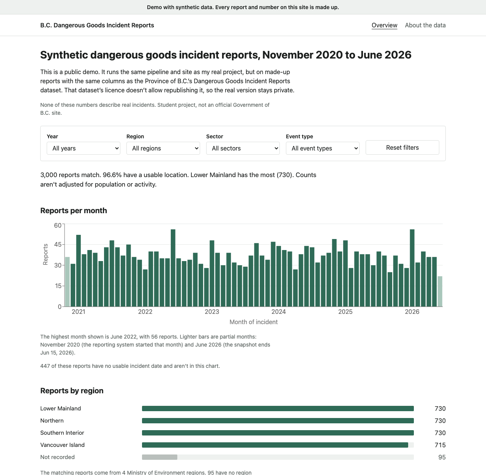

# B.C. Dangerous Goods Incident Reports (public demo)

A Python and SQL pipeline that cleans the Province of B.C.'s Dangerous Goods Incident Reports (DGIR) dataset, and a small static site that shows how the reports break down by month, region, event type, sector and substance class, and how complete each field is.

**This public copy runs on synthetic data.** Every report and number in this repository and on the demo site is made up.



## Why the data is synthetic

I built the project on the [DGIR Incident (PUBLIC Access)](https://catalogue.data.gov.bc.ca/dataset/dangerous-goods-incident-reports-dgir-incident-public-access-) dataset from the B.C. Data Catalogue. When I checked its licence, it was listed as **Access Only**, which doesn't allow republishing without written permission. So the version with real data and real findings is private while I ask the province for permission, and this repository runs the same code on a generated file with the same columns.

`demo/make_synthetic_data.py` writes 3,010 rows. Its proportions are round numbers I picked, not taken from the real data. It deliberately includes the problems I found in the real file, so the pipeline has something to do: missing and impossible dates, blank and "Unknown" categories, a region recorded as `0`, bad coordinates, exact duplicate rows, repeated DGIR numbers and rows with no DGIR number.

## Why I built this

I'm a fourth-year Computing Science student at Thompson Rivers University, and I wanted a data project built on a real government dataset instead of a cleaned-up tutorial file. Most of the work turned out to be deciding what to count: the file looked like one row per material, but it's one row per report, many reports have no incident date, and the licence doesn't allow republishing records. I wanted the site to show those limits next to the numbers, not hide them.

## How it works

```
CSV in the DGIR column layout
  -> pipeline/load.py    read as text, keep 9 columns
  -> pipeline/clean.py   one row per DGIR number + one row per substance class
  -> sql/*.sql (DuckDB)  totals, data quality, pre-counted tables
  -> frontend/public/data/*.json
  -> React site          filters add up the pre-counted rows
```

I used DuckDB because it runs SQL files straight from Python on pandas tables, with no database server to set up. The site only ever loads counts, never individual reports, which is the same design the real version needs for its licence.

## How reports are counted

- Every count is a count of distinct DGIR numbers, not rows.
- When a DGIR number appears twice, the row with the most filled fields is kept and the other is reported as a conflict.
- Materials are packed into one cell (`Diesel; Propane`). The substance class list is split and each class counts once per report.
- Reports with a missing or impossible incident date stay in every total but are left out of the monthly chart, and the site says how many.
- A location is usable when latitude and longitude fall inside a loose box around B.C. Bad coordinates lower the usable-location share but don't remove the report.
- Quantities are never loaded, because litres and kilograms can't be added together.

## Running it

You need Python 3.11 or newer and Node 22.12 or newer.

```bash
python -m venv .venv && source .venv/bin/activate
pip install -r requirements.txt
python demo/make_synthetic_data.py
python -m pipeline build --source data/raw/synthetic_demo.csv

cd frontend
npm install
npm run dev
```

The pipeline also works on the real file: `python -m pipeline fetch` downloads it from the catalogue, and `python -m pipeline inspect --source <file>` prints a profile of it. Keep the output to yourself unless you have permission to republish it.

## Tests

```bash
pytest -q
ruff check . && ruff format --check .

cd frontend
npm test
npm run lint
npm run build
```

The Python tests use a small fixture (`tests/fixtures/synthetic_dgir.csv`) with one fake report for each cleaning rule. The frontend tests check that the site's totals match the SQL totals in `meta.json`.

## What I'd do next

- Get written permission from the province and publish the real version.
- Check whether missing incident dates are spread evenly across years, since that decides whether any trend over time can be trusted.
- Compare two snapshots by DGIR number to measure how often provisional records change.
